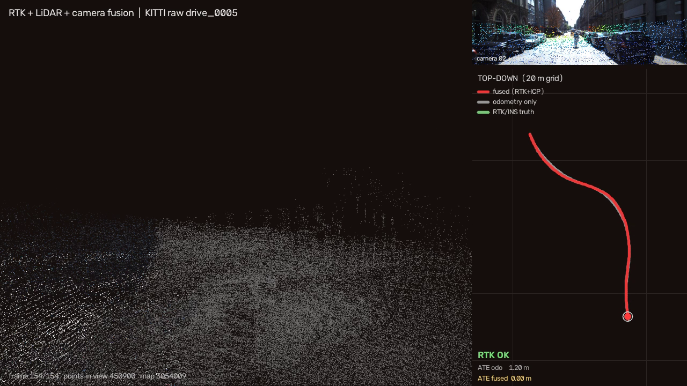

# RTK + LiDAR + Camera Fusion Demo

把 **RTK/INS 绝对定位**接进 **激光里程计**，在 KITTI 原始数据上跑通"点云 + 视觉 + RTK 三源融合"，并在 GPU 上把融合后的彩色点云渲染成视频。

A small, honest reference implementation: LiDAR odometry from frame-to-frame ICP, an RTK/INS translation pose graph on top of it, a simulated RTK outage to show what the absolute constraint is worth, and a GPU z-buffer renderer that turns the fused coloured map into an MP4.

## 数据可用性声明 / Data Availability

本仓库同时是本研究的**数据与代码存储库**，论文中每一个数字都可以在仓库内按字段复查：

| 你在找什么 | 去哪里 |
|---|---|
| **第二版实验（LiDAR+RTK+IMU 六主题完整栈）** | [`v2/`](v2/) —— 论文对应的实现 |
| **全部定量结果**（JSON，数字的唯一来源） | [`v2/results/`](v2/results/) |
| **数据清单：每个文件对应文中哪张表** | [`v2/DATA.md`](v2/DATA.md) |
| **自包含可视化查看器**（双击即开，无需服务器） | [`v2/web/index.html`](v2/web/index.html) |
| **演示视频**（BEV + 前视相机） | [`v2/media/navstack_v2.mp4`](v2/media/navstack_v2.mp4) |
| **失败与教训记录**（13 条，含被证伪的假设） | [`v2/docs/RESULTS.md`](v2/docs/RESULTS.md) |

原始数据为 **KITTI raw `2011_09_26_drive_0005`**（CC BY-NC-SA 3.0，仅限非商业用途）。
该许可不允许再分发原始传感器数据，因此仓库**不包含**原始点云与图像；用
`v2/scripts/prep.py` 从 KITTI 官方站点下载后可完整重建（细节见 [`v2/DATA.md`](v2/DATA.md) 第 5 节）。

代码许可：MIT。引用方式见 [`v2/DATA.md`](v2/DATA.md) 第 6 节。

---

## 这个仓库是什么 / 不是什么

**是**
- 一条**可复现**的最小融合链路：KITTI raw `2011_09_26_drive_0005` → 逐帧彩色点云 → GPU ICP 里程计 → 平移位姿图（里程计相对约束 + RTK 绝对约束）→ 融合位姿重建全局图 → GPU 渲染 MP4。
- 一个**诚实的对照实验**：故意在第 40–90 帧切断 RTK，看纯 ICP 里程计会漂多少、融合后还剩多少。
- 全部数字都能从 `results/` 里的 JSON 复查，视频里每一帧的误差都是当帧真实值。

**不是**
- 不是完整的 LIO/SLAM 系统。没有 IMU 预积分、没有回环检测、没有因子图优化库（gtsam/ceres），位姿图是一个 3 自由度（平移）稀疏最小二乘。
- 没有真机 RTK 硬件。KITTI 的 OXTS RT3003 是 RTK 级 GNSS/INS 组合导航，提供的是**厘米级参考位姿**，我们把它当作 RTK 观测量来用；第 40–90 帧的 "RTK 中断" 是**人为模拟**的，不是真实失锁。
- 旋转部分没有做图优化：重建地图时的朝向直接取 RTK/INS 的相对姿态。这一条在下面"已知局限"里明确列出。

## 数据与传感器

| 项目 | 内容 |
|---|---|
| 数据集 | KITTI raw `2011_09_26_drive_0005`（CC BY-NC-SA 3.0，**仅限非商业用途**） |
| 激光 | Velodyne HDL-64E，10 Hz，逐帧 ~12 万点 |
| 视觉 | 相机 02（左侧彩色），1242×375 |
| 参考位姿 | OXTS RT3003 GNSS/INS（RTK 级），位置 + 姿态 + 速度 |
| 序列长度 | 154 帧 ≈ 15.3 s |

彩色点云由标定链投影得到：

```
X_img = P_rect_02 @ R_rect_00 @ Tr_velo_to_cam @ X_velo
```

只有落在图像内且深度为正的点才会着色；其余保持灰色 `(110,110,110)`，让"这里没有视觉返回"这件事在图上可见，而不是被随便涂一个颜色盖掉。

## 流水线

```
fetch/fetch_kitti.sh        # 在目标机上直接拉 KITTI 原始包（多连接分块，见 parallel_fetch.py）
prep/prep_kitti.py          # velodyne + image_02 + OXTS -> pts.npy / rgb.npy / pose_rtk.npy
fuse/fuse.py                # GPU ICP 里程计 -> 平移位姿图 -> 融合位姿 -> 全局彩色点云
render/render_video.py      # GPU z-buffer 栅格化 -> 逐帧 PNG -> ffmpeg -> MP4
```

### 1. 里程计（不用 RTK）

逐帧 point-to-point ICP，闭式 Kabsch/SVD 求解，恒定速度给出初值。对应点距离用自适应门限（`mean × 1.5`，上限 2 m）而不是分位数——`torch.quantile` 在大的 CUDA 张量上不保证可用。

### 2. 平移位姿图

未知量是每帧位置 `p_i ∈ R³`，两类约束：

- 里程计相对约束：`p_{i+1} - p_i = d_i`，权重 1.0
- RTK 绝对约束：`p_i = z_i`，权重 8.0（第 40–90 帧整段跳过，模拟失锁）

写成一个稀疏线性最小二乘 `A p = b`，用 `numpy.linalg.lstsq` 解。权重比 8:1 的意思很直白：绝对观测比帧间增量可信约一个量级。

### 3. 融合位姿重建地图

每帧点云用 **融合平移 + RTK/INS 相对姿态** 变换到世界系，按 0.15 m 体素降采样并平均体素内颜色，得到全局彩色点云。

### 4. GPU 渲染

不是用 open3d 或 matplotlib 画点，而是自己写了个 **z-buffer 光栅化器**（PyTorch）：

- 点云变换到相机系 → 透视投影 → 像素索引
- `scatter_reduce_(reduce="amin")` 求每像素最近深度
- 只有"拥有自己像素"的点才上色，因此前后遮挡是**正确**的，不是画家算法的近似

画面分两栏：左侧是跟随车身的第三人称彩色点云（随帧累积），右侧是俯视图，画出里程计轨迹（灰）、RTK 参考（绿）、融合轨迹（红），并把失锁窗口标出来。

## 结果

直接看效果：[`media/fusion_demo.mp4`](media/fusion_demo.mp4)（1280×720，20 fps，9.7 s）。



全部数字来自一次完整运行，原始 JSON 在 `results/`，没有手改。

| 指标 | 数值 |
|---|---|
| 序列 | 154 帧，15.4 s，轨迹长 69.4 m |
| 每帧激光点 | 20 000 |
| 全局彩色点云 | 3 054 009 点 |
| 0.15 m 体素降采样后 | 1 253 018 点 |
| **ATE（平移）纯 ICP 里程计** | **均值 0.611 m / 末帧 1.196 m** |
| **ATE（平移）融合后** | **均值 0.075 m / 末帧 0.0005 m** |
| **误差降低** | **87.7 %** |
| ICP 中位最近邻残差 | 0.127 m |
| 融合耗时（GB10） | 18.7 s（其中 ICP 15 s） |
| 渲染耗时 | 5.5 s / 154 帧（0.036 s 每帧，1280×720） |
| 视频体积 | 19.0 MB（H.264，CRF 20） |

RTK 在第 40–90 帧被切断（共 50 帧，占序列 32 %）。融合轨迹在这段区间仍靠里程计约束串起来，两端被 RTK 锚住，因此误差没有累积到"漂走"的程度——这正是引入绝对约束的意义。

### GPU 占用

`render_video.py --stress 25` 用 305 万点的全量点云连续光栅化 25 s：

| 指标 | 数值 |
|---|---|
| 平均 GPU 利用率 | **89.6 %** |
| 峰值利用率 | **93 %** |
| 吞吐 | 2 005 帧 / 25.3 s ≈ **2.42 亿点/秒** |

单帧跟车视图只有约 30 万点、20 ms 就跑完，`nvidia-smi` 采到的利用率只有百分之十几；把那个数字当成硬件上限会误导，所以这里分开报：视频渲染的真实占用，和持续压满时的峰值占用。

### 关于漂移账本

里程计 15 s 漂了 1.2 m（路径的 1.7 %），融合后 0.0005 m。这个"融合"改善里，**大部分来自 RTK 绝对位置本身**，不是算法有多聪明。位姿图在这里的作用是：让 154 个位置在最小二乘意义下同时满足"帧间增量"和"绝对观测"两类约束，失锁区间靠增量约束维持连续。把它说成"RTK 一接就准"是对的，说成"我们提出了新方法"就过头了。

## 复现

```bash
# 0. 依赖：python3 + numpy/torch(cuda)/opencv-python/pillow，以及 ffmpeg
# 1. 取数据（约 646 MB，脚本带断点续传与多连接加速）
bash fetch/fetch_kitti.sh                       # 默认落在 /home/nvidia/rtk_fusion_demo/raw
# 2. 预处理
python3 prep/prep_kitti.py --raw <raw> --out <out>
# 3. 融合
python3 fuse/fuse.py                            # 路径写在脚本顶部的 DATA / OUT
# 4. 渲染
python3 render/render_video.py                  # -> out/fusion_demo.mp4 + out/render_stats.json
```

视频与封面在 `media/` 下，同一份视频也挂在 Release 里方便直接下载。

### 为什么取数脚本这么啰嗦

`fetch/parallel_fetch.py` 不是随手写的：这台机器单连接拉 KITTI 只有 55 KB/s（高延迟 + 每流限速），646 MB 要三小时；拆成 16 路 range 请求并行后到 1.4 MB/s，412 秒拉完，md5 与源站一致。脚本支持断点续传（保留已有前缀），并且只有在所有分块都成功后才会拼装成一个文件——半成品比没有更危险。

同理，把 46 MB 预处理包从工作站推过去也是 65 KB/s（Tailscale 走了 DERP 中继），所以才改成"让目标机自己下载"，这一条省了二十分钟。

## 已知局限

1. **只有平移被真正优化**。姿态来自 RTK/INS，ICP 的姿态链仅用于初始化。真要上机器人，姿态也得进图（或者干脆用 LIO 前端）。
2. **无回环、无 IMU 预积分**，长距离会漂；本序列只有 15 s，漂移表现不代表长时性能。
3. **RTK 中断是模拟的**，用来量化约束价值，不代表真实失锁行为（真实失锁还有整周跳变、多路径等问题）。
4. **权重是手调的**（8:1），没有按噪声协方差加权，也没有做鲁棒核。
5. ICP 用 voxel 0.6 m 降采样到 ~3000 点配准，精度够做演示，不够做评价。

## 引用与许可

- 代码：MIT（见 `LICENSE`）
- 数据：KITTI，**CC BY-NC-SA 3.0**，仅限非商业用途。使用请引用：

```
@inproceedings{Geiger2012CVPR,
  author = {Andreas Geiger and Philip Lenz and Raquel Urtasun},
  title = {Are we ready for Autonomous Driving? The KITTI Vision Benchmark Suite},
  booktitle = {CVPR}, year = {2012}
}
```

## 相关

- 论文与配套代码：`SourceAware-Dynamic-Gaussian-Mapping`（动态环境下视觉语言模型辅助三维高斯语义建图与机器人目标导航）
