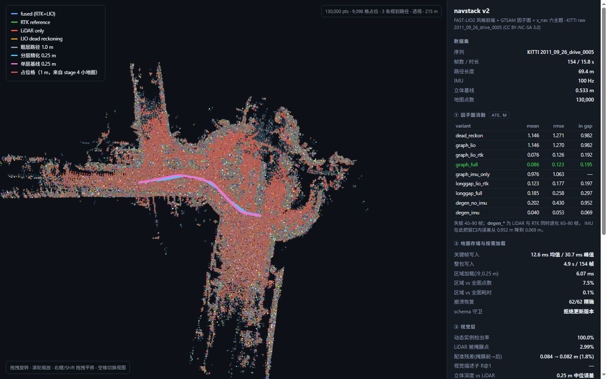

# navstack v2 — LiDAR + RTK + IMU 建图与大地图导航栈

在 **KITTI raw 2011_09_26_drive_0005**（154 帧 / 15.8 s / 69.4 m）上完整跑通的一条导航栈，
把《大地图与多楼层导航栈升级方案》的六个主题逐个实现并用可复查的数字验收。

所有数字都来自本仓库脚本的真实运行，原始结果在 `results/*.json`，没有任何手写或估计值。

---

## 一、这条栈在做什么

```
Velodyne HDL-64E ──► LIO 前端（point-to-plane ICP, GPU）
                          │  相邻帧相对位姿
OXTS RT3003 (100 Hz) ─────┤
                          ├──► GTSAM 因子图 ──► frame0 位姿 + 速度 + IMU bias
RTK 平移（Huber 鲁棒核）───┘
                          │
                          ▼
                   地图存储（原子写 / journal / 游标）──► 分块 + LOD
                          │
                          ├──► 多楼层烘焙与按层加载
                          ├──► Scan Context 重定位（L1 检索 + L2 多假设验证）
                          ├──► 全局轻量层 + 滚动窗口细层 + 分层 A*
                          └──► 视觉层（动态掩膜 / 语义代价层 / 视觉描述子）
```

## 二、三个关键结论（与直觉相反的部分）

**1. IMU 不是「加了就更好」，它的价值只在 LiDAR 也失效时才出现。**

| 场景 | 无 IMU | 有 IMU |
|---|---|---|
| RTK 正常 | 0.076 m | 0.086 m |
| RTK 失锁 40–90 帧 | **0.192 m** | 0.195 m |
| RTK 长失锁 30–120 帧 | **0.197 m** | 0.297 m |
| **LiDAR + RTK 同时退化 60–90 帧** | 0.952 m | **0.069 m（13.8×）** |

在 RTK 单独失锁时 LiDAR 里程计本身已经把窗口撑到 0.2 m，IMU 只能贡献噪声；一旦 LiDAR 也退化，
IMU 是唯一剩下的相对测量，此时它把窗口内误差从 0.952 m 压到 0.069 m。**结论是保留 IMU 因子，
但不要指望它在 GPS 短暂丢星时改善精度** —— 它买的是退化场景的可用性，不是常态精度。

**2. 「用加速度计估计重力方向来初始化姿态」在这段数据上不成立，而且是有害的。**

车全程未停（最低 2.54 m/s，最小 |gyro| 0.40 °/s），没有任何静止段，三种估法的倾角互差 6.3°：
全流平均 0.72°、前 20 帧 4.29°、最静 0.5 s 窗 7.04°。而 1° 姿态误差在 69 m 上就是 1.2 m 位置误差，
比要研究的效应本身还大。实测把 frame0 从单位阵改成加速度计估计后，`graph_lio` 的 ATE 从 1.146 m
劣化到 2.338 m。**正解是让图里的加速度计 bias 项吸收泄漏，而不是去猜重力方向。**

**3. 视觉层里只有动态掩膜动了几何，而且收益不大；真正被低估的是相机对重定位的增益。**

- 动态掩膜让配准残差从 0.0840 降到 0.0824 m（+1.8%）—— 因为 ICP 本身对少量动态点鲁棒，
  它的价值在**地图里不留鬼影**，不在位姿精度。
- 视觉描述子单独用 R@1 只有 0.948（HSV）/ 0.747（tiny image），但作为**重定位第二模态投票**，
  把 Scan Context 的 R@1 从 0.795 提到 0.864 —— 这条是原来最没想到的。

## 三、六个主题的验收数字

| 主题 | 关键指标 | 结果 |
|---|---|---|
| ① 建图实时存储 | 关键帧写入延迟 | 12.6 ms 均值 / 30.7 ms 峰值（帧周期 105 ms） |
| ① | 崩溃恢复 | manifest 回退到 92 帧后，journal 精确补回 62 帧 |
| ② 地图按需加载 | 30 m 区域冷缓存加载（0.25 m） | 6.07 ms，34935 点 |
| ② | 同 LOD 全图加载 | 742 ms，465269 点 → 点占 7.5%，时间占 0.8% |
| ③ 视觉层 | 动态实例检出率 / LiDAR 掩膜点占比 | 见 `results/stage3_vision.json` |
| ④ 多楼层 | 真实数据楼层数 | 1（正确拒绝在单层数据上硬分） |
| ④ | 合成双层：识别 / 分配 / 按层加载省点 | 2 层 / 100% / 49.5% |
| ⑤ 自动重定位 | L1 R@1 / R@5 | 0.795 / 0.886 |
| ⑤ | 旋转 ±90°/180° 不变性 | 1.000 / 1.000 / 1.000 |
| ⑤ | 未建图区域误接受率 | 0% |
| ⑥ 分层导航 | 热启动：1.0 m 粗层 + 滚动 30 m 窗口 vs 整张 0.25 m 单层 | **83.4 ms vs 2295.7 ms（×27.6）** |
| ⑥ | 路径长度偏差 / A* 展开格数比 | **−0.36%** / **×22.4**（52 vs 1203） |
| ⑥ | 消融：窗口层「重建」而非「载入」 | 4219.7 ms，即 **×0.53 —— 比单层还慢约 2 倍** |

## 四、第六主题没那么顺利：细层把路面判成了障碍

第一版 stage6 报出 `flat 0.25 m: expanded 1`，看着像分层规划的胜利，实际是 **0.25 m 细层坏了**。
单层基线 10/10 全部失败，而「分层」10/10 成功 —— 一个 10:0 的结果通常是 bug，不是创新。

点级探针给出的证据：**自车所在的那个 0.25 m 格子里有 44 个带内回波**，高度从地面上 0.20 m
到 1.72 m，来自约 16 个扫描帧。这是**自车本体**（车顶、后视镜、雨刮）的回波，距离 0.1–0.5 m，
任何距离门限都删不掉。所以修复不是调参，而是承认物理事实：**车体占过的格子按定义可通行**。
`clear_footprint()` 在每个关键帧原点周围清出半车宽（0.80 m）的圆盘，并且**在膨胀之后再清一次**。

消融（`results/diag_nav_sweep.json`，10 对查询）：

| 0.25 m 层配置 | A* 成功 | 展开格数 |
|---|---|---|
| 距离门限 30 m，无自车足迹 | **0/10** | 0 |
| 距离门限 30 m + 足迹 0.4 m | 10/10 | 618 |
| 距离门限 30 m + 足迹 0.8 m | 10/10 | 1216 |
| 1.0 m 层，无足迹 | 2/10（路径 224.5 m，绕飞） | 31310 |

顺带修掉的两个次要缺陷：无约束 Laplacian 平滑会把路径削进障碍格（最小净空 **0.00 m**）；
分层路径跨分辨率拼接时，**8.26%** 的顶点（1.0 m 粗层格心）落在细层判定为障碍的格子里，
给窗口层加 0.25/0.50/0.75 m 膨胀余量**三次都是 8.26%**（无效），正解是对这些顶点做
EDT 最近自由格修复。修完两个规划器都是 0.00% 违规、0.25 m 净空。

完整记录（含 13 条失败与教训）见 `docs/RESULTS.md`。

## 五、可视化

两套产物都不需要服务器、不需要联网，`git clone` 下来直接看。

**1. 自包含 WebGL 查看器 —— `web/index.html`（2.7 MB，双击即开）**

数据全部内嵌在单个 HTML 里（点云、占位层栅格、三条规划路径、六段指标），
鼠标左键旋转、滚轮缩放。三个可切换视角对应三种规划器：灰=粗层、青=分层精化、洋红=单层基线。



**2. 鸟瞰 + 相机双画面视频 —— `media/navstack_v2.mp4`（1760×738 / 15 fps / 154 帧 / 10.3 s）**

左侧是 BEV：绿=RTK 真值、蓝=融合估计、黄=当前位姿、红=被视觉层剔除的动态回波；
右侧是前视相机与实时误差读数。抽帧样张：`media/frames/f60.png`、`media/frames/f140.png`。

> 视频里 `ffmpeg` 必须以 `-nostdin` 且 `stdin=DEVNULL` 启动。在 pty 下它读 stdin 取交互键会吃
> SIGTTIN 变成 `State: T (stopped)`，表现为「渲染十分钟毫无进展」——排查花了很久，记在这里。

## 六、复现

```bash
pip install -r requirements.txt

# 1) 数据准备（KITTI raw drive 0005 的 sync + extract 两套）
python scripts/prep.py --raw /path/to/raw --out data

# 2) 全链路
python scripts/run_all.py --data data --raw /path/to/raw --out out

# 或逐段
python scripts/run_stage1.py      # 配准 + 因子图消融
python scripts/run_stage2_map.py  # 地图存储
python scripts/run_stage3_vision.py
python scripts/run_stage4_levels.py
python scripts/run_stage5_relocal.py
python scripts/run_stage6_nav.py
python scripts/export_web.py      # 单文件 WebGL 查看器 -> web/index.html
python scripts/render_video.py    # 鸟瞰 + 相机视频
```

诊断脚本（都是「先用真实命令查证」的产物，不是装饰）：

```bash
python scripts/diag_imu_agreement.py  # LIO 增量 vs IMU 预积分增量是否自洽
python scripts/tune_bias.py           # bias 先验 × frame0 姿态 12 格扫描
python scripts/diag_nav_layer.py      # ego 格与邻格的栅格取值、各分辨率 A* 成败
python scripts/diag_nav_ground.py     # 带内回波相对局部地面的高度分布（证伪地面假设）
python scripts/diag_nav_points.py     # 落在 ego 格里的到底是哪些点、来自哪一帧
python scripts/diag_nav_sweep.py      # 距离门限 × 自车足迹 × 膨胀 的消融
```

`scripts/diag_imu_bias.py` 保留但**结论作废**：它的灵敏度矩阵漏了速度项的二阶项，
反解出 439 m/s² 的荒谬 bias。留档是为了留下失败记录，不是可用结论。

依赖：Python 3.12 + numpy≥2 + torch（CUDA）+ gtsam + OpenCV + scipy。
本机实测解释器：`/home/nvidia/sop-vision/.venv/bin/python`（torch 2.14.0+cu130、gtsam 来自 ROS Jazzy 绑定）。
`run_all.py` 用 `sys.executable` 起各阶段，所以先激活该环境。

## 七、目录

```
navstack/          库代码（每个主题一个模块，映射见 navstack/__init__.py）
scripts/           可执行入口，每段一个 + 六个诊断脚本
results/           全部 json 结果（数字的唯一来源）
docs/RESULTS.md    完整方法与结果说明，含 13 条失败记录
web/index.html     自包含 WebGL 查看器（2.7 MB，数据内嵌，双击即开）
web/preview.png    查看器截图
media/navstack_v2.mp4   鸟瞰 + 相机双画面视频
media/frames/      视频抽帧样张
```

## 八、数据来源

KITTI raw `2011_09_26_drive_0005`（CC BY-NC-SA 3.0），传感器：Velodyne HDL-64E、
彩色相机 02/03（基线 0.533 m）、OXTS RT3003（RTK 级 GNSS/INS，100 Hz）。

`frame0` 约定：首帧 IMU body 系，x 沿行驶方向、z 沿重力（见 `navstack/kitti.py`）。
所有位姿都是 `T_frame0_body`，下游不需要任何额外变换。
